# 화면

시연 사이트: https://aquaguard-omega.vercel.app

### 메인 화면 — 산청군 전역의 지형·하천·도로·대피소와 시간축

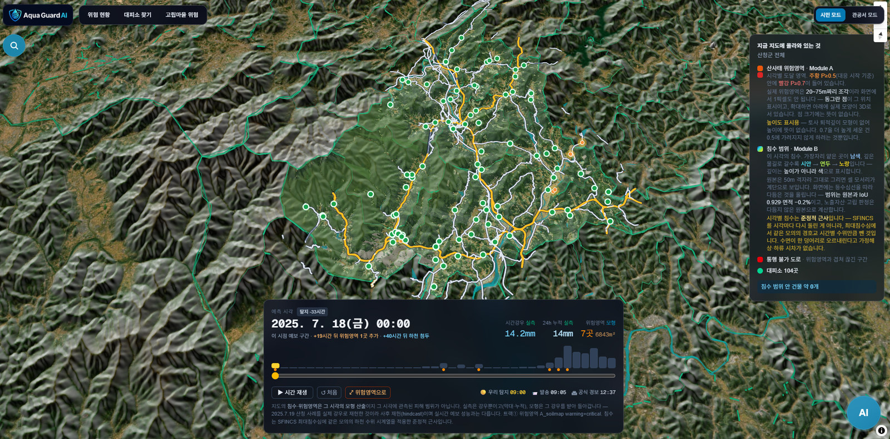

### 하천범람 — 불어난 강물이 농경지와 마을로 번진 모습

### 시간축 비교 ① — 평상시

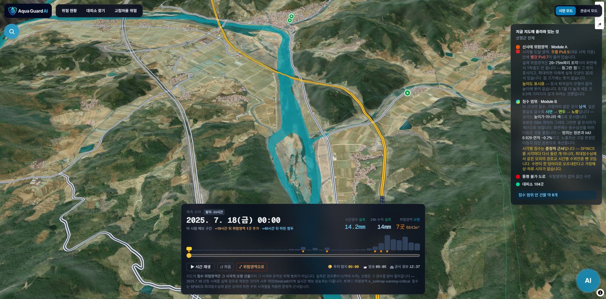

### 시간축 비교 ② — 침수가 가장 넓은 시각, 같은 시점에서 본 모습

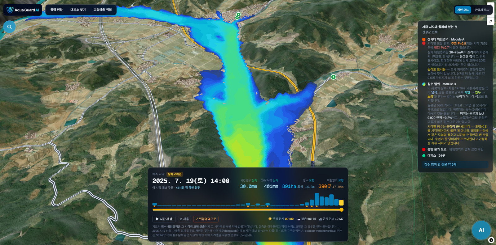

### 침수 깊이 — 깊이를 색으로 표시

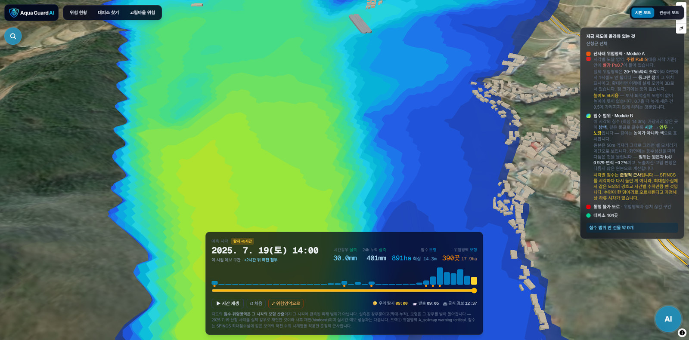

### 끊긴 도로(빨강)와 그 때문에 갇힌 마을(분홍)

### 고립 마을 상세 — 몇 동이 갇히는지

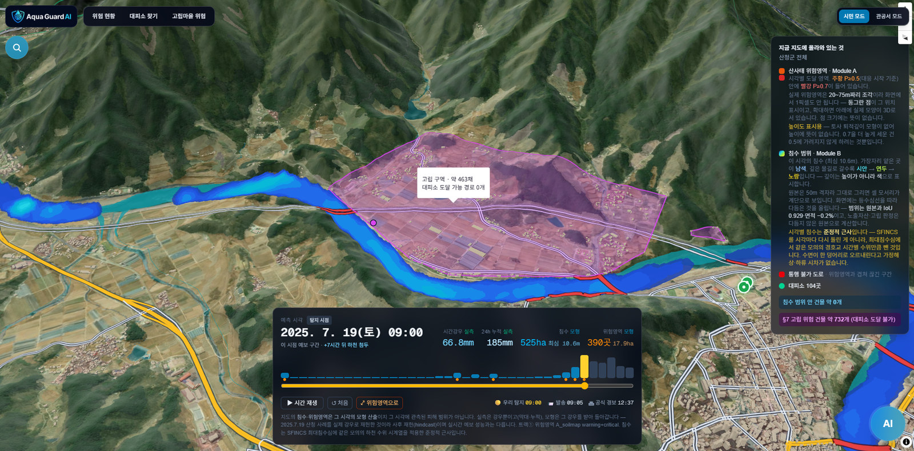

### 대피소까지의 실제 도로 경로와 소요 시간

### 산사태 위험영역

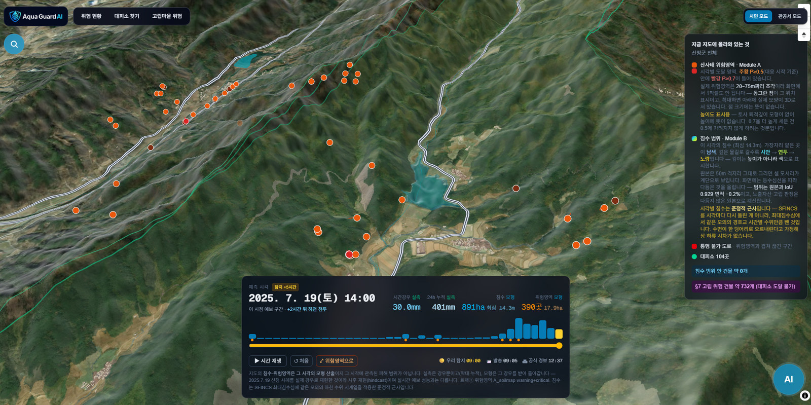

### 건물·도로 3D — 노출 자산 판단의 바탕

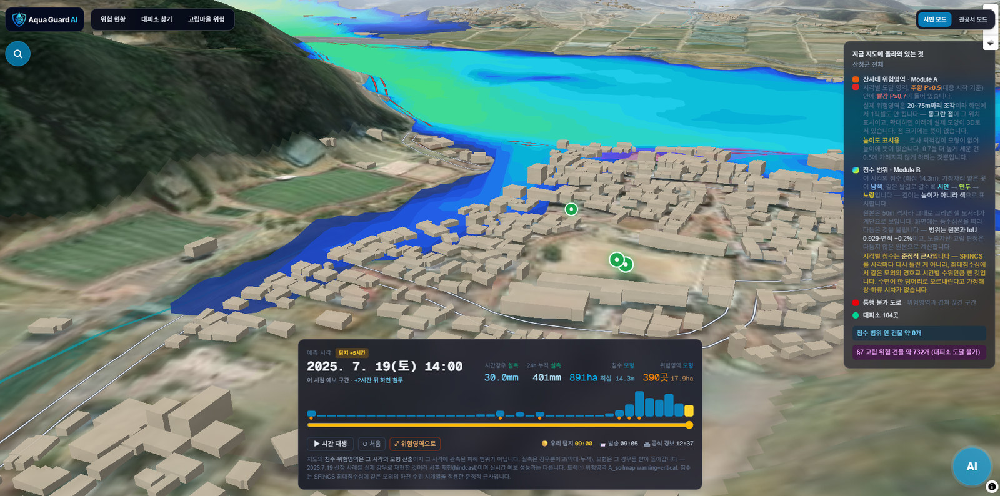

### 시민 모드 — 우리 동네 위험 현황과 값의 출처 배지

### 시민 모드 — 가까운 대피소와 소요 시간

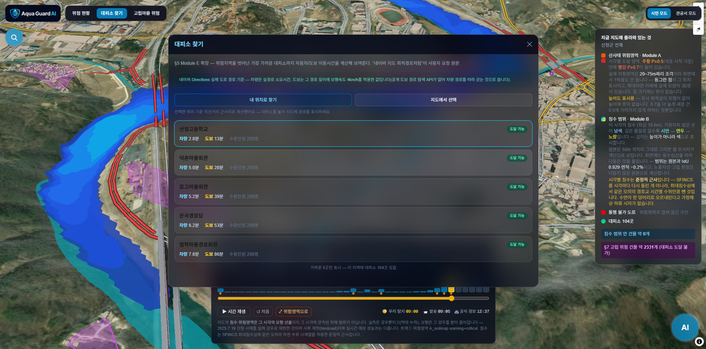

### 시민 모드 — 고립 마을 위험

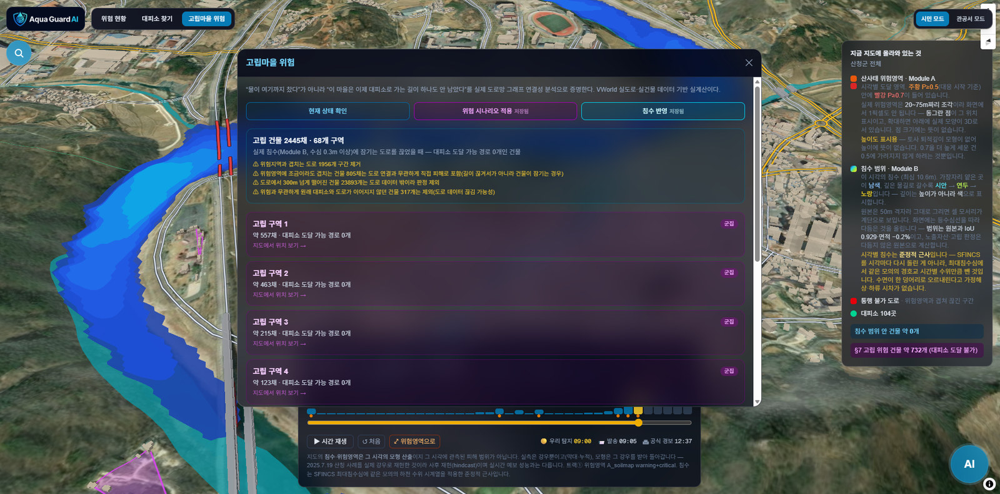

### 관공서 모드 — 골든타임 대시보드

### 관공서 모드 — 모델 성능

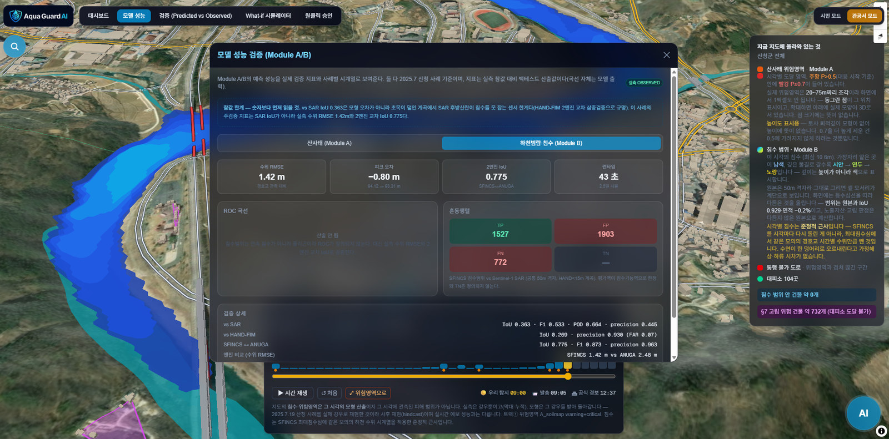

### 관공서 모드 — 예측과 사후 관측 비교

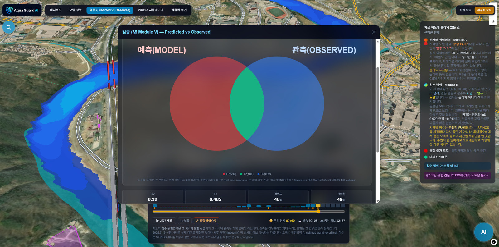

### 관공서 모드 — 원클릭 승인. 대피명령은 사람이 최종 결정

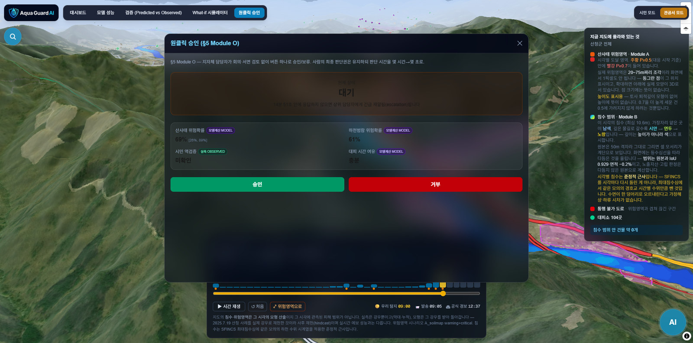

### AI 상담 — 화면에 올라온 경보 정보를 근거로 답변

