

# AquaGuard.AI (아쿠아가드)

**산불–호우 재해연쇄의 골든타임 회복 시스템**

산불로 약해진 사면에 집중호우가 내리면 산사태, 하천 범람, 도로 단절, 마을 고립이 한 사건 안에서 잇따라 일어납니다.
아쿠아가드는 이 사슬을 처음부터 끝까지 이어서 계산합니다. 그리고 경보를 내릴 때 **누구를 어디로 대피시킬지**까지 함께 내놓습니다.

> 🔗 **시연 사이트**: https://aquaguard-omega.vercel.app
>
> 이 저장소는 프로젝트 소개용입니다. 소스 코드는 비공개 저장소에서 관리합니다.

---

## 왜 필요한가

2025년 7월 16~20일 집중호우로 전국에서 37명이 사망하고 12,921명이 대피했습니다.
가장 심각했던 경남 산청군에서는 7월 19일 하루에 산사태 266건이 발생해 13명이 사망하고 1명이 실종됐습니다.
산청군은 그보다 4개월 전인 2025년 3월, 대형 산불이 지나간 피해지였습니다.

이 사건을 시간 순서대로 놓아 보면, 실패한 것은 예측이 아니었습니다.
산림청은 7월 17일에 이미 대피를 권고했지만, 산사태 경보가 실제로 격상된 시각은 7월 19일 12시 37분이었습니다.
위험 신호는 있었고, 그 신호가 판단과 전파 단계를 지나는 동안 여러 시간이 흘러갔습니다.

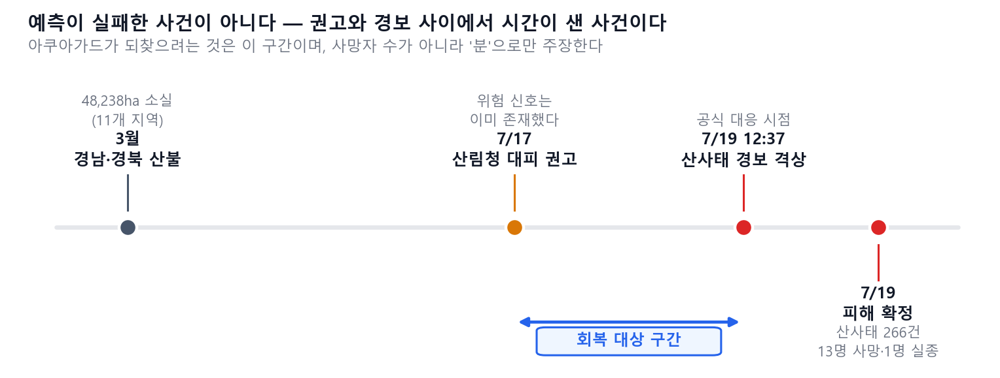

아쿠아가드는 더 정확한 예측 모델 하나를 더 만드는 대신 **신호가 행동으로 바뀌는 데 걸리는 시간**을 줄이는 데 집중합니다.

## 무엇을 하는가

| 기능 | 내용 |
|---|---|
| 재해연쇄 예측 | 산사태 → 하천 범람 → 도로 단절 → 마을 고립을 하나의 흐름으로 계산 |
| 고립 마을 탐지 | 도로가 끊기기 전에 대피해야 하는 마을과 그 시한을 지도에 표시 |
| 대피 경로 안내 | 내 위치에서 안전한 대피소까지 실제 도로 경로와 소요 시간을 안내 |
| 경보 패키지 | 위험·노출 자산·대피 경로·예상 피해를 한 번에 묶어 담당자가 바로 승인할 수 있게 전달 |
| 근거 표시 | 화면의 모든 숫자에 실측값인지 예시값인지 출처를 표시 |
| AI 해설 | 지금 상황과 해야 할 일을 자연어로 물어보고 답을 받음 |

## 화면

**시간에 따라 변하는 침수 범위**
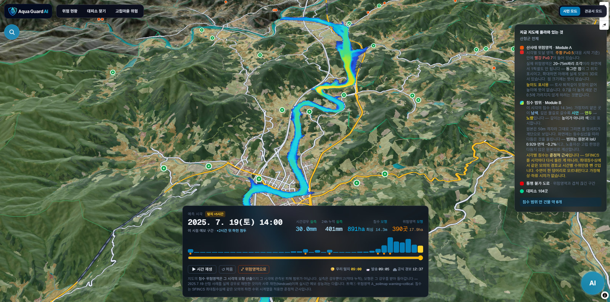

**고립 위험 마을**
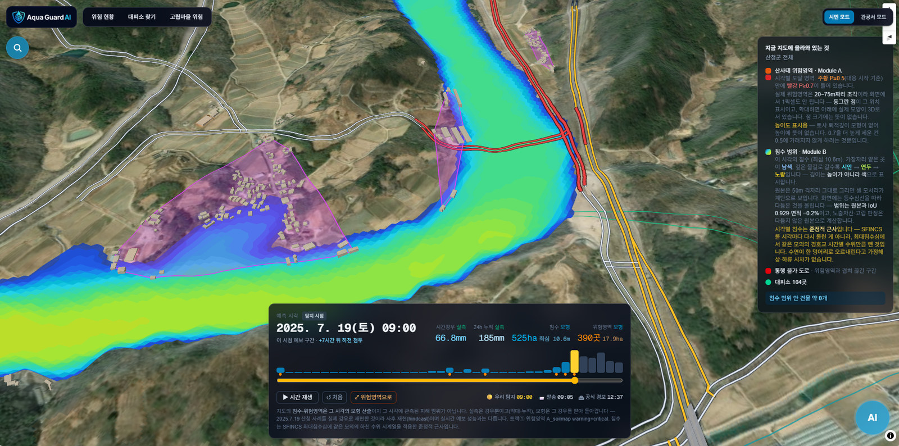

**대피소까지 실제 도로 경로**
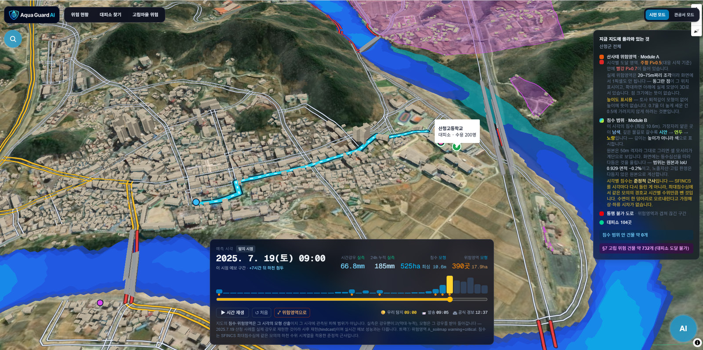

**우리 동네 위험 현황**
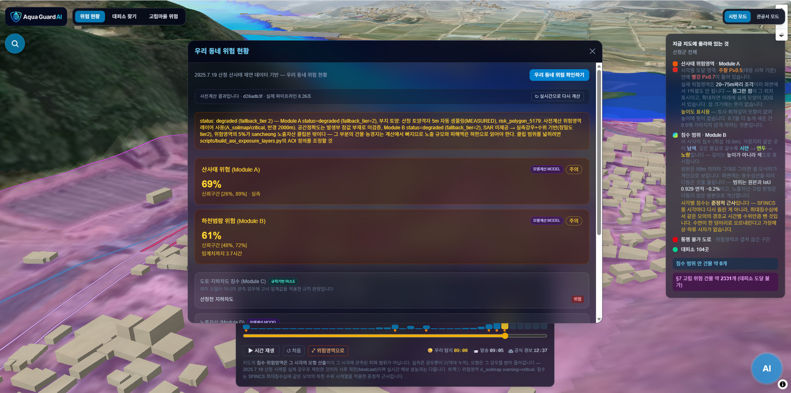

**관공서 모드 — 골든타임 대시보드**
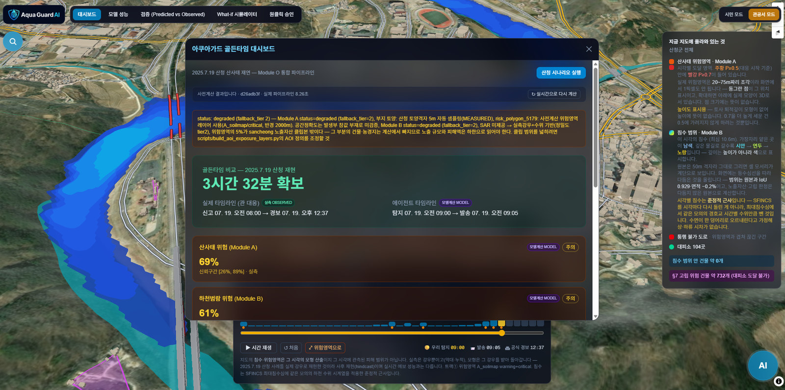

**AI 해설**
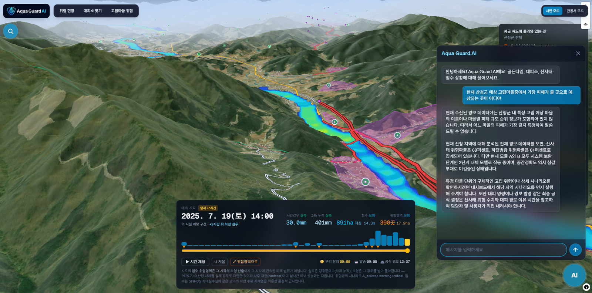

화면 사진 18장 전체는 [FIGURES.md](FIGURES.md)에 있습니다.

## 아키텍처

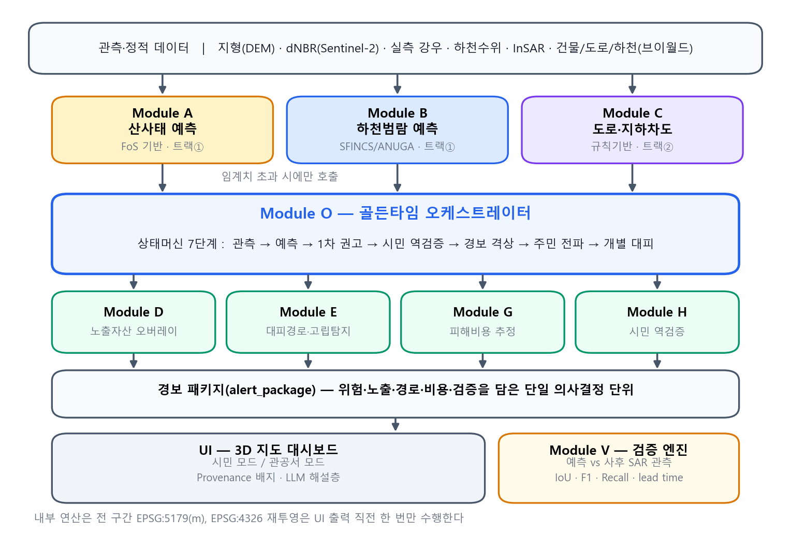

관측 자료가 들어오면 예측 모듈이 위험을 계산하고, 오케스트레이터가 결과를 하나의 경보 패키지로 묶어 화면에 전달합니다.

| | 모듈 | 하는 일 |
|---|---|---|
| **A** | 산사태 예측 | 산불 피해 사면을 반영한 산사태 위험영역 |
| **B** | 하천범람 예측 | 시간에 따라 변하는 침수 범위와 깊이 |
| **C** | 도로·지하차도 | 도로·지하차도 통행 위험 등급 |
| **D** | 노출자산 | 위험영역에 들어가는 건물·농경지 |
| **E** | 대피소·경로 | 대피 경로와 고립 위험 마을 |
| **G** | 피해비용 | 예상 피해 규모 |
| **H** | 시민신고 역검증 | 시민 제보로 예측 신뢰도 보강 |
| **V** | 검증 | 예측과 사후 관측 비교 |
| **O** | 오케스트레이션 | 모듈 결과를 모아 경보 패키지와 골든타임 집계 |

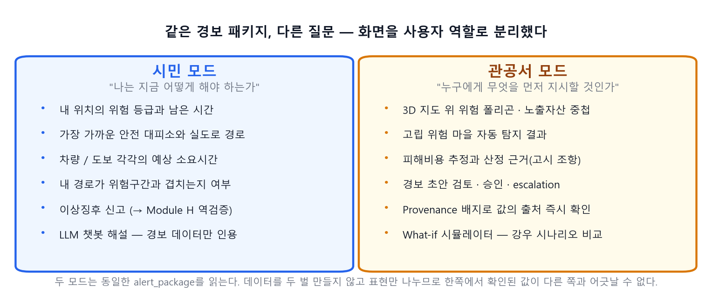

## 2025년 산청 사후 재현 결과

2025년 7월 산청 호우를 사후 재현한 결과, 아쿠아가드는 공식 경보 격상(12:37)보다 **약 3시간 37분 먼저** 위험 신호를 냈습니다.

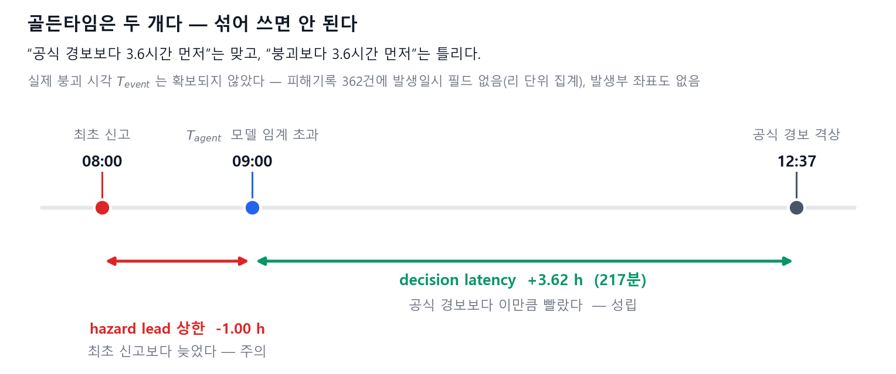

다만 이 수치는 "공식 경보보다 빨랐다"는 뜻입니다. "붕괴보다 빨랐다"는 뜻은 아닙니다.
실제 붕괴 시각 기록은 확보하지 못했습니다.
또 "이 시스템이 있었다면 몇 명을 살릴 수 있었다"는 주장은 하지 않습니다. 그 주장은 대피 순응률, 이동 시간, 현장 접근성까지 검증해야 성립하기 때문입니다.

## 확장 계획

산지 재해에서 출발해 도시 홍수와 내수 침수로 넓혀 갈 계획입니다.

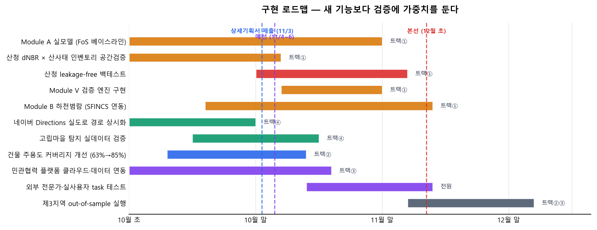

---

## 저작권

Copyright © 2026 AquaGuard.AI. All rights reserved.

이 저장소의 글, 그림, 화면 사진은 허락 없이 복제, 수정, 배포하거나 AI 학습에 쓸 수 없습니다. 자세한 내용은 [LICENSE](LICENSE)를 보십시오.
